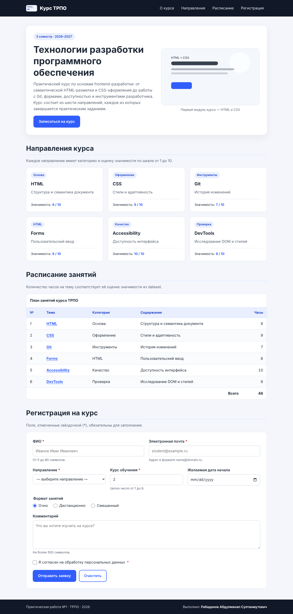
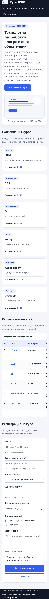

<<<<<<< HEAD
# Практическая работа №1 — HTML и базовая CSS-разметка

## Описание
Многораздельная адаптивная страница на чистых HTML и CSS по данным из
папки `data/`. Содержит шапку, навигацию, hero-блок, карточки, таблицу
и форму регистрации.

## Технологии
- HTML5 (семантическая разметка)
- CSS3 (Grid, Flexbox, медиазапросы, CSS-переменные)

## Структура
- `index.html` — разметка
- `css/styles.css` — стили
- `data/content.csv` — темы и оценки (используется для карточек и таблицы)
- `data/navigation.json` — пункты навигации (соответствуют id секций)
- `images/logo.svg` — логотип в шапке
- `images/cover.svg` — обложка в hero-блоке

## Запуск
1. Открыть папку проекта.
2. Открыть `index.html` в браузере (двойной клик).

## Проверки
- Навигация клавиатурой (Tab) работает, фокус виден.
- Форма валидируется: пустое поле, неверный email, возраст вне 16–99.
- При ширине окна ≤ 760px карточки перестраиваются в 1 колонку.
- В DevTools → Accessibility у всех полей есть label.
=======
# Практическая работа №1. HTML и базовая CSS-разметка. Семантическая структура страницы

**Дисциплина:** Технологии разработки программного обеспечения
**Выполнил:** Рабаданов Абдулманап Султанмутович
**Преподаватель:** Макиевский Станислав Евгеньевич
**Семестр:** 3 семестр, 2026–2027 гг.

## Описание результата

Адаптивная информационная страница учебного курса «Технологии разработки программного обеспечения» на чистых HTML и CSS, без JavaScript и сторонних библиотек. На странице есть шапка с навигацией, вводный раздел с обложкой, шесть карточек направлений, таблица расписания и форма регистрации с встроенной HTML-валидацией. Все данные взяты из папки `dataset`.

**Технологии:** HTML5, CSS3 (Flexbox, медиазапросы, CSS-переменные, псевдоклассы `:focus-visible`, `:user-invalid`, `:user-valid`).

## Запуск

1. Клонируйте репозиторий:
   ```bash
   git clone <ссылка-на-репозиторий>
   cd trpo-pr01-rabadanov
   ```
2. Откройте `index.html` в браузере двойным щелчком. Сервер и установка зависимостей не нужны.

Можно также запустить локальный сервер (по желанию):
```bash
python -m http.server 8000
# затем откройте http://localhost:8000
```

Все пути относительные, поэтому проект работает и после переноса папки в другое место.

## Структура проекта

```
trpo-pr01-rabadanov/
├── index.html          — разметка страницы
├── css/
│   └── styles.css      — все стили (внутри HTML стилей нет)
├── images/
│   ├── logo.svg        — логотип в шапке и favicon (из dataset/assets)
│   └── cover.svg       — обложка в разделе «О курсе» (из dataset/assets)
├── data/
│   ├── content.csv     — исходные данные карточек и таблицы
│   └── navigation.json — исходные данные навигации
├── docs/               — скриншоты проверки
├── README.md
└── .gitignore
```

## Использование файлов dataset

| Файл | Поля | Где используется |
|------|------|------------------|
| `navigation.json` | `label`, `target` | Четыре пункта меню в `<nav>`. `label` — текст ссылки, `target` — `id` раздела: `about`, `tracks`, `schedule`, `signup`. Каждая ссылка `href="#target"` ведёт к существующему `<section id="target">`. |
| `content.csv` | `id`, `title`, `category`, `description`, `value` | 1) Шесть карточек `<article class="card">` в разделе «Направления»: `category` — метка, `title` — заголовок, `description` — текст, `value` — значимость из 10. Поле `id` даёт устойчивые идентификаторы карточек `track-1`…`track-6`. 2) Таблица расписания (6 строк): `id` — номер занятия, `value` — часы, в `tfoot` выводится итог (48 ч). 3) Список `<select>` в форме: `value` пункта равно `id`, текст пункта — `title`. |
| `assets/logo.svg` | — | Логотип в шапке (декоративный, `alt=""`, потому что рядом стоит текст «Курс ТРПО») и favicon. |
| `assets/cover.svg` | — | Содержательное изображение в `<figure>` с осмысленным `alt` и `<figcaption>`. |

Данные из CSV перенесены в HTML вручную. Задание это допускает: все карточки имеют одинаковую структуру и общий набор классов.

## Структура HTML

- `<header class="site-header">` — логотип и `<nav aria-label="Основная навигация">` со списком `<ul>` ссылок.
- `<main id="main">` — основной контент из четырёх `<section>`, у каждой есть `id` и `aria-labelledby`, ссылающийся на её заголовок:
  - `#about` — единственный `<h1>`, описание курса, кнопка-ссылка, `<figure>` с обложкой;
  - `#tracks` — `<h2>` и шесть `<article class="card">` с `<h3>`; число значимости размечено тегом `<data value="…">`;
  - `#schedule` — `<table>` с `<caption>`, `<thead>`, `<tbody>`, `<tfoot>`; у заголовков задан `scope`, тема в каждой строке — ссылка на свою карточку;
  - `#signup` — форма регистрации.
- `<footer class="site-footer">` — сведения о работе и авторе.
- Ссылка «Перейти к основному содержимому» (skip-link) появляется при первом нажатии Tab.

Иерархия заголовков: `h1` → `h2` (разделы) → `h3` (карточки), уровни не пропускаются.

### Форма

| Поле | Тип | Ограничения |
|------|-----|-------------|
| ФИО | `text` | `required`, `minlength="5"`, `maxlength="80"` |
| Электронная почта | `email` | `required`, `maxlength="100"` |
| Направление | `select` | `required`, пустой первый пункт |
| Курс обучения | `number` | `required`, **`min="1"`, `max="6"`, `step="1"`** (числовое ограничение) |
| Желаемая дата начала | `date` | `min="2026-09-01"`, `max="2027-06-30"` |
| Формат занятий | `radio` в `<fieldset>` с `<legend>` | одно значение выбрано по умолчанию |
| Комментарий | `textarea` | `maxlength="500"` |
| Согласие | `checkbox` | `required` |

Каждое поле связано с `<label>` через `for`/`id` или вложением, подсказки подключены через `aria-describedby`.

## Применённые CSS-приёмы

- `box-sizing: border-box` для всех элементов, CSS-переменные для цветов и отступов в `:root`.
- Базовая типографика: системный шрифт, `line-height: 1.6`, адаптивные размеры заголовков через `clamp()`.
- Ограничивающий контейнер `.container` (`max-width: 1100px`, `margin: 0 auto`).
- **Flexbox** с `flex-wrap: wrap`: шапка, hero-блок, сетка карточек (`flex: 1 1 16rem`), строки формы, подвал. При сужении окна элементы переносятся.
- Оформление ссылок (`text-underline-offset`, `:hover`) и заметное состояние фокуса `:focus-visible` (жёлтая обводка) для навигации с клавиатуры.
- Липкая шапка (`position: sticky`) и `scroll-padding-top`, чтобы при переходе по якорю заголовок раздела не прятался под шапку.
- Состояния ошибочного ввода: `:user-invalid` подсвечивает поле и подсказку красным, `:user-valid` подсвечивает корректное поле зелёным. Эти классы срабатывают только после взаимодействия с полем, поэтому пустая форма при загрузке не подсвечивается.
- Широкая таблица прокручивается внутри обёртки `.table-wrap` (`overflow-x: auto`), а не всей страницей.
- Медиазапросы:
  - `max-width: 768px` — шапка перестраивается в колонку (`flex-direction: column`);
  - `max-width: 480px` — уменьшаются отступы, кнопки формы растягиваются на всю ширину, подвал выстраивается в колонку.
- Методология именования классов в стиле BEM: `.card`, `.card__title`, `.button--secondary`.

## Проверка

- Chromium DevTools: ошибок в Console нет, все запросы в Network успешны (код 200).
- Дублей `id` нет, все якорные ссылки ведут к существующим элементам, у всех полей формы есть `label`, у содержательного изображения есть `alt`.
- Горизонтальной прокрутки нет ни на 1280 px, ни на 375 px.
- Навигация с клавиатуры: Tab проходит по skip-link → меню → кнопке → ссылкам таблицы → полям формы, фокус всегда виден.
- Ошибочный сценарий: отправка пустой формы блокируется браузером, а при вводе `Ab` в ФИО, `bad` в email и `9` в поле курса поля подсвечиваются красным, браузер показывает сообщение об ошибке. Скриншот: `docs/screenshot-form-invalid.png`.

| Десктоп (1280 px) | Мобильный (375 px) |
|---|---|
|  |  |
>>>>>>> 17596466c10a82993ec93e3ec3baad38d7381ac9
